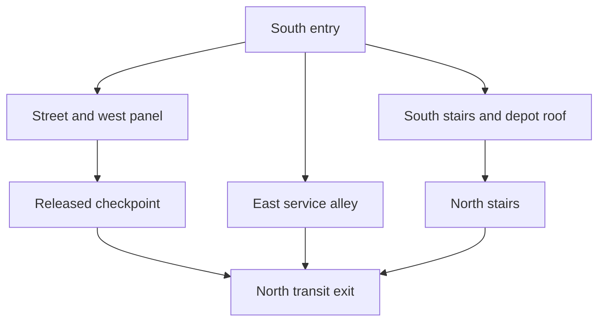

# ACTS AND MAPS

**Project:** Last Ronin Project  
**Version:** 1.0 — evidence consolidation, 12 October 2026  
**Owner of creative decisions:** Kevin Graham

## Authority and evidence labels

This document preserves the recoverable project, including all five story arcs. It does not invent missing story, maps, dialogue, boss phases, or numerical tuning. Full verbatim transcripts were not available through retrieval; 52 current project-folder files were inventoried, the latest production package and block source were read, selected art was visually inspected, and prior conversation context was retrieved. A complete approved screenplay and complete chapter list were not found.

- **LOCKED:** explicit current user instruction or recovered user decision.
- **RECOVERED PLAN:** prior narrative/design plan; detailed approval may not be recoverable.
- **PROTOTYPE:** behavior or content in an existing build; existence does not establish final design approval.
- **LEGACY:** earlier Hollow Signal experiment; reusable reference, not automatic campaign canon.
- **TBD:** missing, conflicting, or insufficiently specified.
- **PRODUCTION REQUIREMENT:** implementation/handoff criterion derived from the chosen direction, not a newly approved creative feature.

Current instructions override older prototype behavior: fixed orthographic camera, graphic-novel art, 3D characters, modular 2D environments. Keep the whole campaign in scope. The first production milestone is one complete playable city block; it is not the whole game.

## Source register

| Source | Material | Use and limit |
| --- | --- | --- |
| U0 | Current request, 12 October 2026 | Locks four-document scope and visual representation |
| C1 | The Last Ronin, 10–11 October; retrieved conversation context | Earlier Hollow Signal experiment and orthographic correction |
| C2 | Last Ronin Game Direction, 11–12 October; retrieved context | Story-first Michelangelo adaptation, five story arcs, character production, later return-first proposal; not a full transcript |
| C3 | Production planning and Game Building Comparison, 12 October; retrieved context | All-act scope, first playable block, 3DAIStudio/Blender/Mixamo and hybrid environment intent |
| P1 | Last_Ronin_Production_Package.zip, created 12 October 2026 | Read source review, scope inventory, asset manifests and integration contracts; secondary compilation, not independent creative approval |
| B1 | Last_Ronin_Act1_Block01_v02.html and Last_Ronin_Block01_v02_Source_and_QA.zip | Current inspected traversal source and historical QA; not a completed combat game |
| L1 | hollow_signal_orthographic_computer.html; earlier phone/desktop counterparts cataloged | Earlier separate combat experiment |
| R1 | Last Ronin Michelangelo Turnaround.png | Visually inspected hooded character reference |
| R2 | Rainy Neon Cathedral Showdown.png; Rainlit Chains: Neon City Showdown.png | Visually inspected early city mood references; generated names/signage are not approved geography |
| R3 | Last_Ronin_Block01_v02_Roof.png | Visually inspected layout/blockout evidence; not final-art approval |
| R4 | Sci-Fi Robot Soldier Turnaround.png; Futuristic Red-Visor Synth Soldier Turnaround.png; Armored Ninja Turnaround Sheet.png | Visually inspected blue-gray, white/red, and purple-accent designs |

The production package catalogs other turnarounds and model screenshots. Their identity mappings are secondary evidence here unless specifically resolved below. No usable rigged model/export or final animation was recovered. No runtime QA was rerun for this documentation task. Do not read historical QA counts as fresh certification.

## Chronology: preserve both records without inventing chapter order

The early outline uses five chronological/thematic acts. The later prototype opens with **Act I / Return to New York**, and retrieved later planning describes a return-first campaign with flashbacks. These are two different numbering schemes, not permission to delete the family material.

| Stable scope label | Earlier act name | Later presentation evidence |
| --- | --- | --- |
| FAMILY | I — Before the Fall — The Family | Family material may occur in flashbacks; position TBD |
| FALL | II — The Fall — Deaths of the Family | Brothers' losses retained; exact chapter order TBD |
| LOST | III — The Lost Years — Becoming the Ronin | Exile and mastery retained |
| RETURN | IV — Return to New York — The Revenge | Current prototype labels the return **Act I**; later plan includes Resistance material |
| FINAL | V — The Final Mission — The Last Ronin | Hiroto confrontation and emotional closure retained |

Use these stable labels when connecting work until D01 resolves the final presentation graph. Roman numerals in inherited CHR/LOC/MIS tables refer to the **earlier thematic scheme**, not shipping chapter numbers. A retrieved assistant summary mentions **13 playable chapters**, but their complete names, boundaries and user approval were not recovered. Thirteen is not a validated production count. A failed-assault opening is a recovered proposal; the exact failure, rescue, and flashback transitions remain TBD.

## Campaign-wide coverage

This is the complete recovered location and mission inventory, not a claim that the unrecovered campaign maps are already designed. Existing IDs from the production package are preserved so later work can refer to the same scope.

| Story arc | Known locations | Mission packages | Environment coverage | Missing map information |
| --- | --- | --- | --- | --- |
| FAMILY | LOC16 | MIS03–04 | ENV045 family kit | Named setting, spaces, route graph, tutorial/team mission count |
| FALL | LOC17–19 | MIS05–07 | ENV046–048 | Confrontation sites, attack layout, Japan sublocations and staging |
| LOST | LOC20 | MIS08–10 | ENV049 | Countries, named stops, travel order, survival/training layouts |
| RETURN | LOC21–22; BLOCK01 belongs to return-era geography | MIS11–13; BLOCK01 MIS01–02 | ENV001–044 and ENV050 | District count, ally-story spaces, encounter map and chronology |
| FINAL | LOC23–24 | MIS14–17 | ENV051 | Approach, stronghold floors, escalation, arena and closure space |
| Proposed failed-assault opening | LOC25 | MIS18 | ENV052 / possible reuse | Approved sequence, map reuse, failure/rescue handoff |

A later assistant plan claimed 13 chapters; the 18 MIS rows below are recovered **mission/beat packages**, not 18 chapters and not a replacement chapter list.

## All recovered locations
| ID | Location | Scope | State | Source | Notes / missing scope |
| --- | --- | --- | --- | --- | --- |
| LOC01 | Outer District / BLOCK01 | M1; story act TBD | Current prototype | S01 | Occupied New York block; production milestone independent of chronology |
| LOC02 | East River entry | BLOCK01 | Prototype geometry | S01 | South entry arch, spawn [0,0,28.5] |
| LOC03 | Main street | BLOCK01 | Prototype geometry | S01 | 12 m carriageway; two 4 m sidewalks |
| LOC04 | Cross street | BLOCK01 | Prototype geometry | S01 | 8 m intersection |
| LOC05 | Diner block | BLOCK01 | Prototype geometry | S01 | Closed facade; draft family memory landmark; no interior |
| LOC06 | Residential block | BLOCK01 | Prototype geometry | S01 | Balconies/closed lobby; no interior |
| LOC07 | Abandoned apartments | BLOCK01 | Prototype geometry | S01 | Boarded tenement; decorative fire escape |
| LOC08 | Service block | BLOCK01 | Prototype geometry | S01 | Industrial shutters; maintenance signs |
| LOC09 | Maintenance depot | BLOCK01 | Prototype geometry | S01 | 4.8 m roof; south/north stairs |
| LOC10 | Service alley | BLOCK01 | Prototype geometry | S01 | Ground bypass at x about 11.5 |
| LOC11 | Foot checkpoint | BLOCK01 | Prototype geometry | S01 | Gate and west-side release control |
| LOC12 | North utility | BLOCK01 | Prototype geometry | S01 | Boundary building; no interior |
| LOC13 | North apartments | BLOCK01 | Prototype geometry | S01 | Boundary building; no interior |
| LOC14 | North transit exit / tower approach | BLOCK01 | Prototype geometry | S01 | Current completion trigger; not a tower level |
| LOC15 | Distant Hiroto tower and skyline | BLOCK01 | Prototype geometry | S01 | Background silhouette only |
| LOC16 | Family training/teamwork setting | I | Scope placeholder; production blocked | S04 | Location name, room count and layout missing; do not assume sewer lair |
| LOC17 | Raphael–Karai confrontation setting | II | Scope placeholder; production blocked | S04 | Exact site missing |
| LOC18 | Baxter attack / Leonardo sacrifice setting | II | Scope placeholder; production blocked | S04 | Exact site missing |
| LOC19 | Japan last-stand setting | II | Scope placeholder; production blocked | S04 | Japan specified; exact site and sublocations missing |
| LOC20 | Exile / survival / training journey settings | III | Scope placeholder; production blocked | S04 | Countries, number, names and map graph missing |
| LOC21 | Occupied New York connected areas | IV | Scope placeholder; production blocked | S04 | Largest connected area; exact district count missing; reuse BLOCK01 only after chronology resolution |
| LOC22 | April / Casey Marie / Resistance story settings | IV | Scope placeholder; production blocked | S04 | No hub or interior layout specified |
| LOC23 | Hiroto stronghold | V | Scope placeholder; production blocked | S04 | Infiltration destination; floors and approach graph missing |
| LOC24 | Final confrontation / closure setting | V | Scope placeholder; production blocked | S04 | Arena and ending locations missing |
| LOC25 | Failed-assault prologue setting | Prologue proposal | Scope placeholder; production blocked | S04 | Sequence and reuse of occupied-city/stronghold spaces unresolved |
| LOC26 | Rain District / arrival | Legacy only | Reference implementation, not campaign canon | S02 | Legacy Hollow Signal setting |
| LOC27 | Patrol Contact arena | Legacy only | Reference implementation, not campaign canon | S02 | First legacy wave encounter |
| LOC28 | Surveillance Court | Legacy only | Reference implementation, not campaign canon | S02 | Melee, shield and drone legacy encounter |
| LOC29 | Street Keeper / Gatekeeper arena | Legacy only | Reference implementation, not campaign canon | S02 | Legacy boss; not Hiroto |
| LOC30 | Spire service access / terminal | Legacy only | Reference implementation, not campaign canon | S02 | Legacy completion gate |
| LOC31 | Meridian / skyline | Legacy only | Reference implementation, not campaign canon | S02 | Legacy background naming, not approved Ronin geography |

## All recovered mission and narrative packages
| ID | Beat | Act | Location IDs | Source | Missing details |
| --- | --- | --- | --- | --- | --- |
| MIS01 | Reach north transit exit | BLOCK01 | LOC01 | S01 | Three existing routes; gate panel for street route; narrative/combat brief missing |
| MIS02 | Diner family-memory interaction | BLOCK01 | LOC05 | S01 draft | Draft note only; flashback content not implemented or approved |
| MIS03 | Family training | I | LOC16 | S04 | Playable training; exact objectives, protagonist and lesson sequence missing |
| MIS04 | Family teamwork and relationships | I | LOC16 | S04 | AI-controlled brothers; team mission count and relationship scenes missing |
| MIS05 | Raphael’s final confrontation with Karai | II | LOC17 | S04 | Playable flashback intent; control assignment and staging missing |
| MIS06 | Leonardo’s sacrifice during Baxter Stockman attack | II | LOC18 | S04 | Encounter roster, exact objective and scripted outcome missing |
| MIS07 | Donatello and Splinter’s last stand in Japan | II | LOC19 | S04 | Exact sequence, roles and battle layout missing |
| MIS08 | Exile and survival | III | LOC20 | S04 | Beat package, not invented mission; exact encounters/locations missing |
| MIS09 | Training / mastering brothers’ weapons | III | LOC20 | S04 | Weapon roster, unlock sequence and challenges missing |
| MIS10 | Journey toward vengeance / grief | III | LOC20 | S04 | Narrative beat package; scene count and triggers missing |
| MIS11 | Explore occupied New York and fight Synjas | IV | LOC21 | S04 | Connected routes/combat; mission and district counts missing |
| MIS12 | April, Casey Marie and Resistance story | IV | LOC22 | S04 | Scene order, objectives and ally roles missing |
| MIS13 | Optional secrets and exploration | IV | LOC21 | S04 | Exact secrets, rewards and persistence policy missing |
| MIS14 | Infiltrate Hiroto’s stronghold | V | LOC23 | S04 | Approach and security sequence missing |
| MIS15 | Escalating stronghold encounters | V | LOC23 | S04 | Enemy mix, encounter count and pacing missing |
| MIS16 | Michelangelo’s final confrontation with Hiroto | V | LOC24 | S04 | Boss phases, arena and narrative result staging missing |
| MIS17 | Bittersweet conclusion / emotional closure | V | LOC24 | S04 | Final scene content and completion-state contract missing |
| MIS18 | Failed-assault prologue | Prologue proposal | LOC25 | S04 proposal | Hybrid chronology not verified as final; do not schedule invented chapters |

## BLOCK01 — current map specification

**Status:** implemented traversal blockout, not a completed first act. **Setting:** Outer District, occupied future New York. **Current destination:** north transit boundary near the tower approach. **Current entry:** East River-side south entry. These names describe B1's authored layout, not a verified real-world New York street map.

### Geometry and boundaries

- Spawn is approximately `[0, 0, 28.5]` in B1 world coordinates.
- Main carriageway is 12 m wide, with two 4 m sidewalks; cross street is 8 m wide. These are prototype dimensions to preserve until an intentional approved layout change.
- Seven building volumes: diner, residential block, abandoned apartments, service block, maintenance depot, north utility and north apartments.
- The maintenance roof is 4.8 m above ground. South ascent spans approximately z=-12 to -24; north descent z=-40 to -52, centered around x=9.75 in the existing specification.
- Service alley is an independent ground bypass around x≈11.5.
- The Foot checkpoint has a west-side release panel. The skyline/Hiroto tower is background only.
- Diner/lobbies/buildings have no completed interiors. Fire escapes and balconies do not establish climb mechanics.

### Preserved route graph

| Route | Traversal | Current requirement | Preserve when adding combat/art |
| --- | --- | --- | --- |
| Street | Main road/sidewalk to checkpoint | Use release panel to open gate | Closed/open collision must agree with art |
| Roof | East-side south stairs, depot roof, north stairs | Grounded ascent/descent; no jump required | Correct roof height, rail clearance and occlusion |
| Alley | East-side service passage | Ground bypass | Keep navigable; do not add a gate prerequisite |

No new connection from the exit into a playable tower exists. The block's exit interaction currently displays a prototype-complete message. Story transition content must be authored separately.

### Interactions

| Interaction | Current state | Final content still needed |
| --- | --- | --- |
| Checkpoint release | Opens gate and records local visited state | Persistence, encounter coupling if approved, final animation/audio |
| Diner memory location | Optional draft note | Approved text, memory presentation and story flag |
| Other environment notes | Layout/camera test text | Decide final retained interactions and wording |
| North exit | Marks environment pass complete | Actual next mission/scene/spawn and save transition |

### First complete playable-block milestone

The previously requested milestone is one finished gameplay segment combining the selected environment, player, encounter, story/interaction and retry behavior. The existing environment-only route test does not satisfy it.

Production acceptance: all three routes work with final hybrid art; fixed-camera visibility is reliable; the agreed player/combat subset works; the chosen approved enemy encounter has a complete start/resolve/reset lifecycle; gate and optional interaction states are correct; the exit completes the authored segment; desktop and phone actions work; one real user model can replace its stand-in without controller rewrites. Exact encounter roster, placement, story brief and numerical performance targets remain D04/D09, so completion cannot currently be certified.

## Later-act map requirements

These describe the information needed to build the recovered story, not invented rooms or quests.

### FAMILY

Provide the named training/teamwork setting, complete area list, player and brother start positions, traversal constraints, interaction anchors and authored team objectives. The environment kit must support all approved family scenes. A sewer hideout is not assumed. Missing: every concrete room and mission layout.

### FALL

Provide separate briefs for the Raphael–Karai confrontation, Baxter attack/Leonardo sacrifice, and Japan last stand. Each must define actor roles, boundaries, attack/escape space if called for, scene triggers and the scripted-outcome transition. Missing: exact locations, geometry, enemy composition and whether each confrontation includes a controllable boss.

### LOST

Provide the complete ordered journey map, each survival/training location, trial objectives and return exits. Link approved weapon mastery to its actual challenge and state change. Missing: all named locations, quantities and travel connections. Do not populate empty scope with generic temples, deserts or mountains.

### RETURN

Expand the occupied city from approved area briefs, using compatible modular kits. Define connected district entrances/exits, ally-story locations and optional exploration paths. Link the failed-assault/recovery proposal only after chronology is resolved. Missing: full district count, Resistance mission chain, ally spaces and placement of BLOCK01 within the story.

### FINAL

Define the stronghold approach, all infiltration/escalation spaces, Hiroto confrontation location and ending presentation. Missing: floors, room graph, boss arena, transition triggers and final outcome staging. A distant tower silhouette is not an authored stronghold map.

## Map handoff contract

For each approved location provide: stable LOC ID, story label and eventual chapter, mission IDs, exact entry/exit connections, world dimensions and elevations, camera framing, modular ENV IDs, unique landmarks, collision/navigation surfaces, actor IDs and placements, interactions, narrative triggers, checkpoints, completion/failure conditions, optional content and required assets. Quantities remain TBD until every approved map has this breakdown.

For each mission provide: controlled character and era, prerequisites, objective sequence, mandatory/optional flags, encounter actors, state changes, success trigger, retry rules, dialogue/cinematic references and destination. There is no complete campaign coverage until every required map/mission is concrete or explicitly excluded by the user.

## Legacy geography boundary

LOC26–31 and their Rain District, Surveillance Court, Gatekeeper, Spire and Meridian names belong to Hollow Signal. They remain reference records only. No automatic mapping to New York, the Foot or Hiroto is authorized.

## Related documents

[GAME_BIBLE.md](GAME_BIBLE.md) supplies the recovered full story. [ART_BIBLE.md](ART_BIBLE.md) contains all environment families and visual rules. [GAMEPLAY_SYSTEMS.md](GAMEPLAY_SYSTEMS.md) supplies mechanical state and validation contracts.
