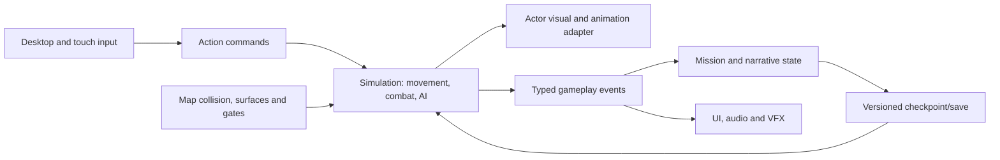

# Technical specification

Version 1.0 • 12 October 2026 • Production contract, not a claim of completed implementation.

## Scope and authority

The four design sources are [GAME_BIBLE](GAME_BIBLE.md), [ART_BIBLE](ART_BIBLE.md), [ACTS_AND_MAPS](ACTS_AND_MAPS.md) and [GAMEPLAY_SYSTEMS](GAMEPLAY_SYSTEMS.md). All five arcs remain in scope. Fixed angled orthographic view, graphic-novel appearance, 3D characters and modular 2D environments are locked. This document defines implementation boundaries and migration gates; it does not invent chapter order, boss phases, weapon tuning or new traversal mechanics.

Three bibles were found at the GitHub repository root, not in `docs/`. Their unchanged copies and the fourth document from the earlier workspace now form the complete `docs/` reference set. The sources' statements that no repository, usable model or animation was recovered describe their earlier inventory. The fresh inspection below supersedes those **availability** claims only.

## Verified source registry and current state

Registry aliases are provenance locations, not runtime paths. They must never be hardcoded into new game/tool code. Resolve them locally during a separately assigned intake task. [PROJECT_INVENTORY.json](inspection/PROJECT_INVENTORY.json) records inspected files, SHA-256 hashes and source roots.

| Alias | Actual location on this machine | Finding |
| --- | --- | --- |
| `repo` | `/Users/kevingraham/Documents/GitHub/LastRonin` | Remote `https://github.com/kevingraham523/LastRonin.git`; baseline `12388c4` contains three root bibles and AGENTS. No runtime or art was tracked at inspection. |
| `legacy_animation` | `/Users/kevingraham/Documents/ChatGPT/Last Ronin` | Three delivered Blender libraries, source motion, scripts, previews and QA; separate Git checkout. Also contains the fourth design document. |
| `downloads` | `/Users/kevingraham/Downloads` | Current HTML, original Godot folder, corrected Godot ZIP, user FBXs and character reference PNGs. |
| B1 | `downloads/Last_Ronin_Act1_Block01_v02.html` | 611-line self-contained raw WebGL2/JavaScript traversal prototype. No build dependencies, Three.js or external model loader. Inline JS syntax passes Node check. Not browser-playtested in this documentation task. |
| G0 | `downloads/Last_Ronin_Act1_Stage1/` | Original Godot folder: main scene, world/player scripts, procedural geometry. Fresh Godot 4.6.2 import reports parse error in `world.gd:112` (tuple-unpacking loop). Preserve for provenance. |
| G3 | `downloads/Last_Ronin_Act1_Stage1_v3_Syntax_Fix.zip` | Corrected five-file project differs from G0. Temporary copy imports without script parse errors and runs 60 headless frames in Godot 4.6.2. This is an older map, not B1 parity. |
| A1 | `legacy_animation/Ronin_Animation_Library.blend` | Fresh read-only inspection in Blender 5.2.1 LTS confirms 11 Ronin actions plus one diagnostic. Action records match the earlier inspection. Not an engine export. |
| A2 / A3 | `legacy_animation/Ronin_Sad_Walk.blend`, `Ronin_Walk_Rig.blend` | Preserved standalone deliveries; earlier metadata/QA read. Current-library timing is not interchangeable with original 24 fps walk timing. |
| L1 / P1 | `hollow_signal_orthographic_computer.html`, `Last_Ronin_Production_Package.zip` | Referenced in bibles but not located in the bounded Documents/Downloads search. Legacy combat/package claims remain documentary evidence, not freshly inspected code. |

The GitHub checkout is a production planning repository at this point. No playable game is included in this commit. Source code and binary assets remain at their original locations. Fetching a repository clone cannot fetch these external files; source intake and binary storage policy are P0 work.

## Systems actually found

| Area | B1 source evidence | Missing or incomplete |
| --- | --- | --- |
| Rendering | `Graphics`, `Builder`, procedural atlas/shaders, outlines, shadows, rain overlay | No skinned GLB loader, final 2D kit or tested hybrid depth pipeline. Visible geometry is a layout reference. |
| Movement / collision | `physics`, `moveBy`, `groundAt`, `blockedAt`; camera-relative walk/run/dash, substeps, gravity, stairs/roof | Final tuning, nav for enemies, animation coupling and expanded traversal. |
| Camera | `cameraUpdate`, `updateBasis`; orthographic follow and facade fade | Shipping rotation must be disabled under locked direction; exact art camera and phone framing pending. |
| Interaction / objectives | `findInteraction`, `interact`; gate, draft notes, north completion modal | Real mission graph, approved narrative, encounter coupling, persistent flags. |
| Input / UI | Desktop movement/run/dash/use; touch controls; map, pause, settings, focus handlers | Combat actions, approved binding reconciliation and actual-device parity tests. |
| Persistence | `localStorage` settings, validated JSON import/export | Campaign saves, checkpoints and chronology isolation. Settings export is not a save game. |
| Characters / animation | Procedural `drawRonin` and stationary `drawSynja`; atmosphere vehicle | Actual library/model import, skeleton binding, sockets, hit volumes and transition system. |
| Combat / AI / progression | None in B1; legacy description only | SYS06–17 and SYS24 need design plus implementation; no enemy behavior inferred from a stationary proxy. |
| Godot | G3 procedural world, CharacterBody3D marker, orthographic camera | No combat/quests/saving/final art; no synchronized BLOCK01 routes; no export presets. |

Current B1 values are regression references, not approved balancing: spawn `[0,0,28.5]`; bounds X `[-28,28]`, Z `[-57,30]`; road 12 m; sidewalks 4 m; cross street 8 m; roof 4.8 m; actor collision radius .34 m and height band 1.95 m; walk 4.5 m/s, run ×1.65, dash 12 m/s for .23 s with .80 s cooldown. Default yaw 35°, pitch 46°, vertical span 24 m. Street release, roof stairs and alley remain independent routes. The skyline is not a playable stronghold.

## Target architecture

The following modules are planned; they are not existing files. Retain the HTML baseline while extracting seams incrementally. Keep engine-specific rendering/physics behind adapters; share IDs, data schemas, event semantics and acceptance fixtures, not JavaScript source inside GDScript.



| Boundary / future owner | Browser implementation direction | Godot implementation direction |
| --- | --- | --- |
| Input, gameplay | Abstract action names around existing handlers | InputMap adapters for same semantic commands |
| Actor motor, gameplay | Preserve tested collision behavior behind motor interface | CharacterBody3D wrapper; explicit foot origin and separate visual child |
| World, environment | Extract B1 geometry/surface/route metadata; keep legacy renderer usable | Environment scenes and invisible spatial collision/navigation, modular illustrated visible art |
| Visual adapter, gameplay + accepted animation delivery | Loading/skinning spike required; raw renderer currently cannot import the rig | Imported GLB under wrapper, Skeleton3D and AnimationPlayer/AnimationTree; no controller code inside imported asset |
| Mission/combat/save, gameplay | Data and simulation functions independent of DOM/render timing | Same schemas and test scenarios using resources/scripts; no node-path-based save identity |
| Release/metadata, integration | Reproducible local server/package with relative assets | Pinned engine/build hash, export templates/presets, tested desktop/web artifacts |

Reserved layout: `assets/characters/<actor>/` and `assets/environments/<kit>/` for authoring and export candidates; `tools/blender/{animation,environment}/` for portable tools; `prototype/` for browser intake and evolution; `godot/` as future project root; accepted character runtime assets under `godot/characters/`, environment scenes under `godot/environments/`. No symlink to a personal Downloads directory may be required to run a clean clone.

Integration owns shared contracts/manifests; animation supplies data and clips; environment supplies art and world metadata; gameplay consumes both and owns simulation. See [AGENTS](../AGENTS.md) for exact path ownership and [INTEGRATION_CONTRACTS](INTEGRATION_CONTRACTS.md) for schemas.

## Migration with preservation gates

| Stage / board task | Work | Exit evidence |
| --- | --- | --- |
| 0 / P0-01 | Copy approved external baselines into versioned intake locations with hashes; retain originals; decide binary storage before mass import | Fresh clone can locate all accepted sources; corrected ZIP and broken original are distinguishable. No LFS history rewrite. |
| 1 / P0-02 | Pin Godot target, renderer, templates, browser support and an exact baseline; compare G3 against B1 | Version recorded; reproducible startup; B1 reference retained. G3 does not become parity baseline solely because it starts. |
| 2 / P0-03, P0-07 | Fixed-camera hybrid spike with one real Ronin and facade/roof/stair/gate modules | Projection, scale, occlusion, skin/export/alpha behavior and phone readability demonstrated. Select browser skinned rendering approach here. |
| 3 / G-SYS01–05, G-SYS20 | Extract input/world/motor/settings boundaries with route fixtures | B1 street/roof/alley and settings behavior still work; no wholesale rewrite. |
| 4 / M1-01–04 | Add approved combat, enemy, story and retry subset to browser segment | Complete M1 criteria in QA; model replacement leaves movement and missions unchanged. |
| 5 / G-SYS23 | Port accepted behavior and data to Godot one system at a time | Same spawn, routes, gate semantics, encounter, checkpoints and input scenarios; visual timing within agreed tolerances. |
| 6 / each arc's tasks | Build content against stable interfaces | All five arcs covered; final graph, save/resume and ending tested. |

Do not delete HTML on first Godot import. Keep the approved browser reference available until parity is accepted. Freeze a parity revision and log later changes once; do not maintain two divergent game designs. Choose long-term browser/Godot maintenance policy in D05. Three.js or Sprite3D are candidates for the spike, not installed systems.

## Running what exists

The current HTML needs a browser with WebGL2. It is self-contained and can be opened directly; for consistent origin behavior serve a **copy** from a scratch directory:

```sh
mkdir -p /tmp/last-ronin-browser-review
cp '/Users/kevingraham/Downloads/Last_Ronin_Act1_Block01_v02.html' /tmp/last-ronin-browser-review/
python3 -m http.server 8765 --bind 127.0.0.1 --directory /tmp/last-ronin-browser-review
```

Open `http://127.0.0.1:8765/Last_Ronin_Act1_Block01_v02.html`. WASD/arrows move; Shift run; Space dash; E use; M map; Esc pause/close. Q/R rotate only in this existing inspection prototype. Touch joystick, Run, Dash and Use exist. This procedure runs traversal, not the complete game.

For Godot, extract the corrected G3 ZIP into a new scratch folder without replacing G0, then open its `project.godot` in the selected engine and run `main.tscn`. The available executable used for checks was `/Users/kevingraham/Downloads/Godot.app/Contents/MacOS/Godot`, version `4.6.2.stable.official.71f334935`. Example after extraction:

```sh
godot --headless --editor --path <scratch-project-directory> --quit
godot --headless --path <scratch-project-directory> --quit-after 60
godot --path <scratch-project-directory>
```

`godot` is a placeholder for that executable if it is not on PATH. Engine startup alone does not prove correct rendering or route parity. G0 parse failure is confirmed; G3 has no script errors in this smoke test. Sandbox editor-settings write errors and a macOS certificate-store warning were also observed; see QA evidence. No original project was changed to resolve them. The G3 project advertises feature version 4.3 while its README targets 4.6.x; 4.6.2 is a tested candidate, not a selected shipping version.

For animation, open a **working copy** of A1 in Blender 5.2.1 LTS. The delivered current clip is the 30 fps in-place Mutant Run, frames 1–44. The standalone weighted walk uses 24 fps. Read the manifest before changing action ranges. No game exporter or engine animation integration currently exists.

## Open technical decisions

| Design decision | New evidence / remaining choice | Owner and production gate |
| --- | --- | --- |
| D01 | Stable arcs retained; final presentation graph and BLOCK01 placement unresolved | Kevin + lead; all story integration |
| D02 | Hybrid representation locked; numeric camera, pixels/world scale, layering/occlusion and alpha technique need representative scene approval | Environment + gameplay; P0-03 |
| D03 / D08 | One usable authored Ronin rig now found; final CHR01 reference/era mapping and other reported models still unverified; no engine export | Animation + Kevin; P0-04 |
| D04 / D07 | M1 enemy/weapon subset, damage/cancel timing, unified controls and runtime root-motion choice unapproved | Kevin + gameplay/animation; P0-05 |
| D05 | Repo found; sources external. Choose intake/storage policy, engine version, renderer/export targets and browser skinning/maintenance approach | Integration + gameplay; P0-01/02/07 |
| D06 / D12 | Per-act maps/scripts, prologue and finale staging incomplete | Kevin + lead; arc briefs |
| D09 | Target desktop/phone devices, frame-time, memory, texture/loading budgets missing | Gameplay + environment + Kevin; P0-06 |
| D10 / D14 | Audio/scene delivery, exact art references, subtitle/skip policy incomplete | Kevin + lead; P1-01/02 |
| D11 | Jump/climb/etc. not approved gameplay despite existing Jump clip | Kevin; P1-03, do not add implicitly |
| D13 | Role capacity, dates and estimates not assigned | Lead; schedule after dependencies are sized |

The technical contract chooses stable IDs, units, wrappers, provenance and event ownership now. Provisional tuning or technology candidates remain explicitly provisional; missing values block promotion to READY, not preservation work.

Godot's official documentation describes imported animation configuration and using an AnimationTree in a containing scene; use the documentation for the engine version selected at P0-02: [import configuration](https://docs.godotengine.org/en/stable/tutorials/assets_pipeline/importing_3d_scenes/import_configuration.html), [AnimationTree](https://docs.godotengine.org/en/stable/tutorials/animation/animation_tree.html). These are implementation references, not evidence that this project has already adopted them.
